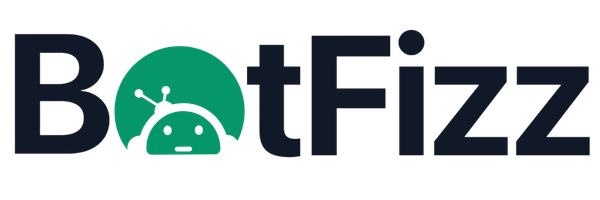
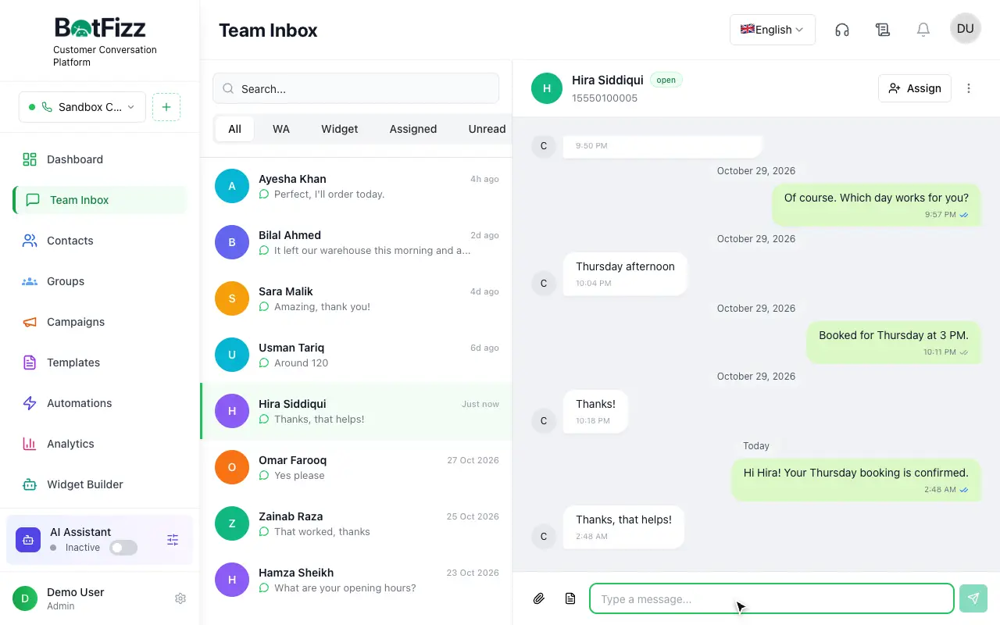
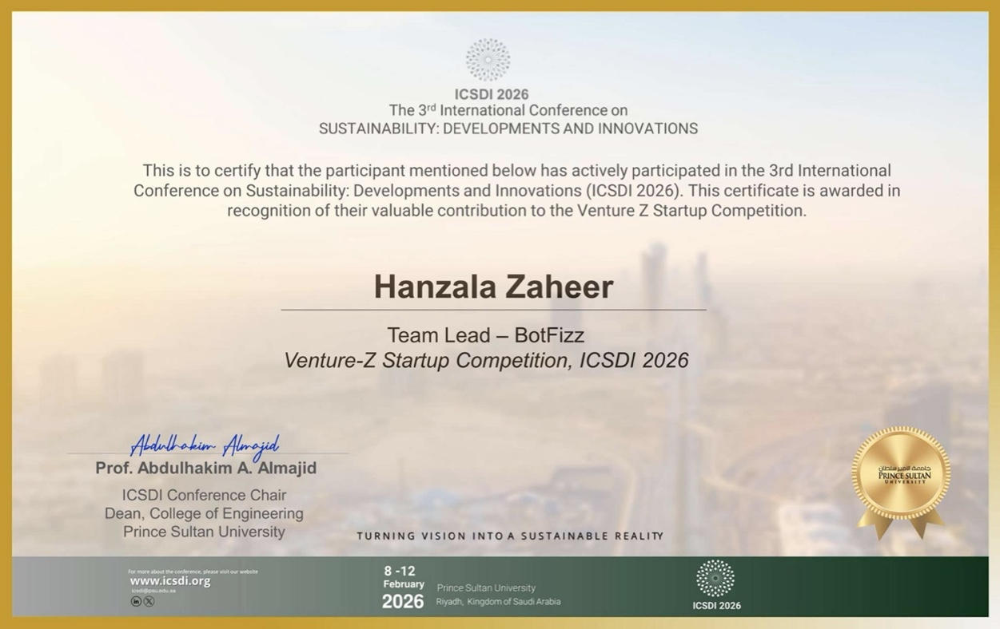
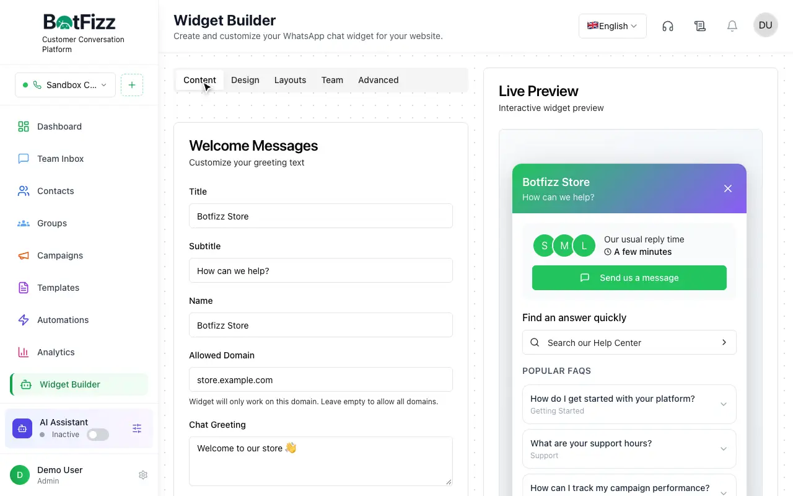
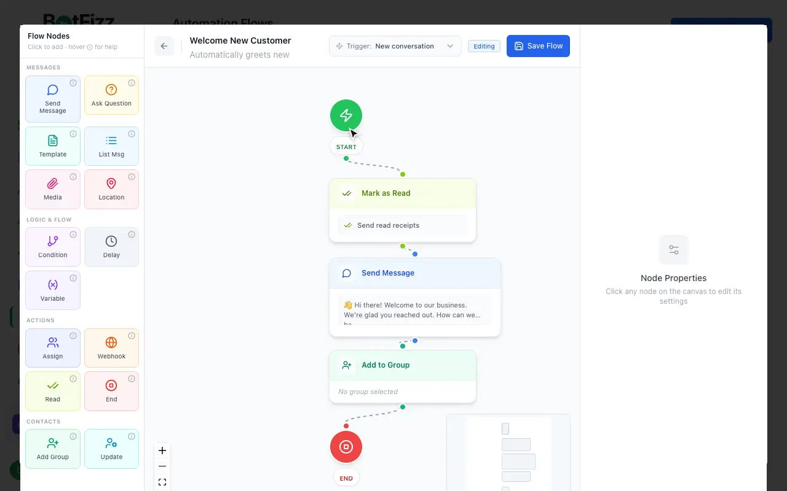
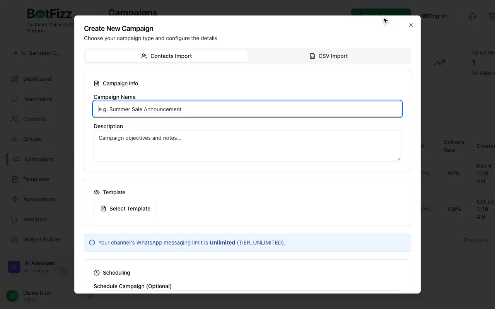
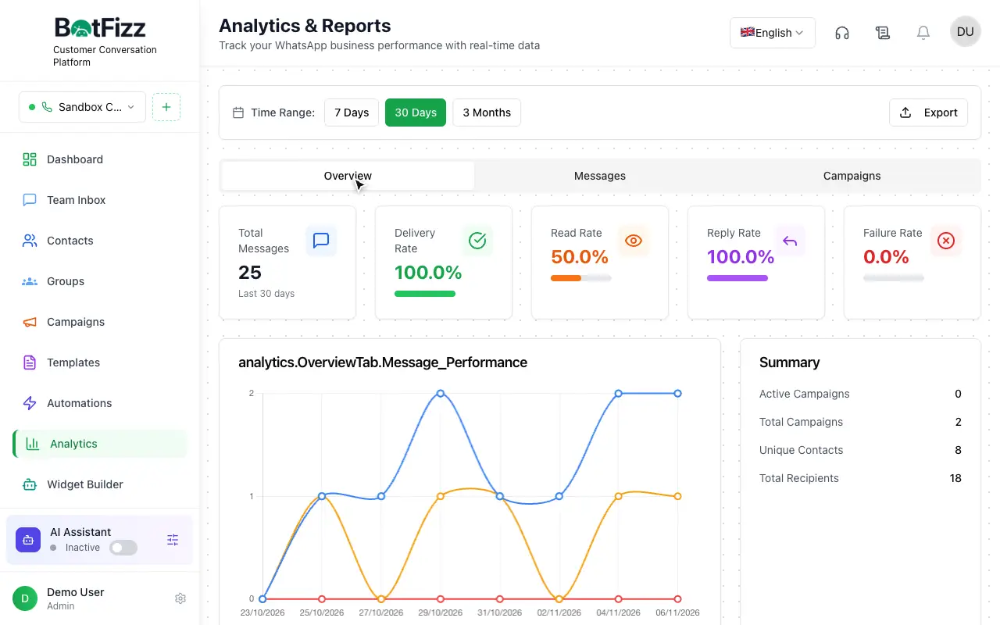

<div align="center">



### Every customer conversation. One platform.

An open-source customer conversation platform with a team inbox, chatbot builder,
website widget, campaigns and analytics.

[](.github/workflows/ci.yml)
[](LICENSE)


**Live demo: see the link in this repository's description.** No sign-up needed.



</div>

## About

Botfizz is the final year capstone project of **Hanzala Zaheer** and **Waleed Shams**
at the **University of Gujrat**. It gives a business one place to talk to customers,
automate routine replies, reach audiences and measure the results.

### Recognition

Botfizz took part in the **Venture-Z Startup Competition** at **ICSDI 2026**, the 3rd
International Conference on Sustainability: Developments and Innovations, held at
Prince Sultan University in Riyadh, Saudi Arabia, on 8–12 February 2026. Hanzala Zaheer
received a certificate as Team Lead of BotFizz, in recognition of a valuable
contribution to the competition.



## Features

| Feature | What it does |
| --- | --- |
| **Team Inbox** | Shared, real-time conversations with assignment, status and unread tracking |
| **Widget Builder** | Design a website chat widget with a live preview and a one-line install |
| **Flow Builder** | Build automations on a drag-and-drop canvas, with no code |
| **Campaigns** | Send to groups or CSV lists, schedule ahead and track delivery |
| **Templates** | Reusable messages with variables, buttons and media |
| **Contacts** | Groups, tags, search, and bulk import and export |
| **Analytics** | Delivery funnel, campaign reports and exports |
| **Team and roles** | Invite teammates with granular permissions |
| **Admin console** | Manage businesses, channels, message logs, languages and support tickets |
| **REST API and webhooks** | Documented endpoints for connecting your own systems |
| **Internationalisation** | 8 interface languages, including right-to-left Arabic |

## Screenshots

| Widget Builder | Flow Builder |
| --- | --- |
|  |  |

| Campaigns | Analytics |
| --- | --- |
|  |  |

## Tech stack

| Layer | Technology |
| --- | --- |
| Frontend | React, TypeScript, Vite, Tailwind CSS, Radix UI, TanStack Query, React Flow |
| Backend | Node.js, Express, TypeScript, Socket.IO |
| Database | PostgreSQL with Drizzle ORM |
| Background work | Database-polling queue, with optional BullMQ on Redis |
| Landing page | Hand-written WebGL, with no 3D library |

## Project structure

```text
.
├── client/                 React application
│   ├── public/             Static assets, demo data and feature clips
│   └── src/
│       ├── components/     Shared and feature components
│       ├── contexts/       Auth, channel and socket providers
│       ├── demo/           Browser-only API for the static demo
│       ├── lib/            Utilities and translations
│       └── pages/          Routes
├── server/                 Express API
│   ├── controllers/        Request handlers
│   ├── repositories/       Data access
│   ├── routes/             API routes
│   ├── services/           Messaging, queues and automation
│   └── sandbox.ts          Local simulation of external services
├── shared/                 Database schema and shared types
└── packages/botfizz-core/  Shared logging and constants
```

## Getting started

**Requirements:** Node.js 20 or newer and PostgreSQL 14 or newer. No API keys are needed.

```bash
# 1. Install dependencies
npm install

# 2. Create the database and its tables
createdb botfizz_demo
DATABASE_URL=postgresql://localhost:5432/botfizz_demo npx drizzle-kit push

# 3. Add a session secret
cp .env.example .env

# 4. Start in sandbox mode
npm run dev:local
```

Open <http://localhost:3000>. Sandbox mode creates two demo accounts with sample data
and simulates messaging and email locally, so nothing leaves your machine.

| Demo account | Username | Password |
| --- | --- | --- |
| Business dashboard | `demo` | `Demo@12345` |
| Platform admin | `demo-admin` | `Demo@12345` |

## Scripts

| Command | Purpose |
| --- | --- |
| `npm run dev:local` | Run locally in sandbox mode |
| `npm run dev` | Run in development with the settings in `.env` |
| `npm run build` | Build the client and server for production |
| `npm run build:demo` | Build the static, server-free demo |
| `npm run start` | Start the production build |
| `npm run db:push` | Apply the schema to the database |

## Configuration

Settings live in `.env`, and [.env.example](.env.example) lists all of them.

| Variable | Required | Purpose |
| --- | --- | --- |
| `DATABASE_URL` | Yes | PostgreSQL connection string |
| `SESSION_SECRET` | Yes | Signs session cookies |
| `APP_URL` | Production | Public URL of the app |
| `CORS_ORIGINS` | Production | Allowed origins, comma separated |
| `REDIS_URL` | No | Enables BullMQ and multi-instance sockets |
| `SANDBOX_MODE` | No | Simulates external services; ignored in production |

## Deployment

**Live demo.** [netlify.toml](netlify.toml) builds a static site that runs entirely in the
browser. It answers API calls from recorded sample responses, and changes reset on reload.

**Full application.** Run `npm run build`, then `npm run start` on any Node.js host with
PostgreSQL. [ecosystem.config.cjs](ecosystem.config.cjs) and
[nginx.conf.example](nginx.conf.example) are starting points for PM2 and Nginx.

## Security

Please report vulnerabilities as described in [SECURITY.md](SECURITY.md).

## Team

| Name | Role |
| --- | --- |
| **Hanzala Zaheer** | Team Lead and Developer |
| **Waleed Shams** | Developer |

## License

Released under the [MIT License](LICENSE).
